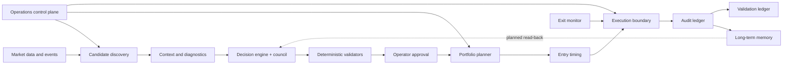

# The Kestrel Engine, Architecture

A kestrel windhovers: it flies into a heavy headwind while holding its head
mathematically still, watches the ground below, and dives at the exact moment.
That is the design ethos. Patience in chaos, deterministic timing, surgical
action.

This document names the engine's fourteen named components (thirteen numbered
slots, with Apex as 9b), the role each plays, the AI agents some of them own,
and the failure modes worth watching. The vocabulary is deliberately
distinct from file paths, so logs and conversation can say "Fulcrum's trend
filter is too tight" instead of naming a module.

The spine of the system is a single rule: **language models do the judgment,
deterministic code holds the veto.** Models research, diagnose, rank, and
critique. Arithmetic, thresholds, sizing, validation, and state transitions live
in code. Nothing a model produces reaches a real order until it clears hard
checks in plain Python, nothing opens a new position until a human has
explicitly approved the name, and adds to a held name stop on the operator's
standing do-not-add or exit verdict.

## What this document discloses

Component names, responsibilities, boundaries, the control model, the arming
posture, the cadence and the model providers are public. The following are
intentionally absent, because they are the edge: exact decision thresholds,
scoring weights, allocation tables and sizing math, the sub-sector cyclicality
model, universe inclusion rules, agent prompt contracts, live positions, fills,
PnL, account data, environment variables beyond the three in the public flag
registry, run commands, and operational runbooks. Where a public code file keeps
its structure, the calibrated numbers have been withheld; the largest modules
are published as excerpts.

## Theme: a cybernetic predator

The engine is structured like an autonomous bio-mechanical organism:

- **Sensory system** gathers raw environmental data.
- **Neural processing** weighs probabilities and synthesizes decisions.
- **Predatory instincts** react mechanically at the moment of opportunity.
- **Physical layer** routes orders and records reality.

## System flow



The dotted edge is the one honest gap in the loop: memory is written on every
run and read by the operator, but no analysis stage reads the per-name memory
back yet. The one cross-week read-back today is the council's own issue
ledger, which carries each critic warning until a later critic resolves it.

## Two orchestrations, one artifact

The research pipeline runs in two shapes that produce the same canonical
synthesis artifact: a single-process weekend run with per-candidate
checkpoints (the production path), and a disk-broken staged pipeline used for
re-synthesis. Both feed the same consumers: Engram, Zenith and the operator's
review chain. The weekend chain is a sequence of gated steps:

```
preflight -> research run -> postcheck -> diff -> digest -> loss-side check
```

Each step's exit code gates the next, except the diff, which is advisory.
Postcheck is a hard gate; a synthesis
that fails it never reaches the watcher. After the digest the operator reviews
each promotable name and records explicit approvals; on the next trading
morning the live plan is rebuilt from those approvals plus the held book by its
single writer.

---

## Phase 1, Sensory system

Raw environmental data ingestion. No reasoning here, just acquisition.

### 1. Aperture
The lens. Scans the broader NSE universe and narrows it to "fallen angels":
names in deep drawdown from their recent high that are worth deeper research.
This stage measures only the fall; quality is judged by the stages after it.

- **Agents**: none on the run path (pure Python). Universe maintenance uses an
  assigner-reviewer pair of agents (see Kernel).
- **Inputs**: instrument master, daily candles for the configured universe.
- **Outputs**: a ranked, reproducible candidate set with price, recent high,
  drawdown and sector.
- **Public-safe note**: universe maintenance is separated from per-run
  screening, and the scan is rerunnable, cacheable, and auditable. A fresh
  structural break such as a demerger, or a rebased name whose post-break fall
  no longer qualifies, is taken out of the band before any model sees the
  name; a held name goes to review instead. The inclusion
  rules, drawdown band, and rejected buckets are withheld.
- **Failure modes**: stale universe list, split or dividend artifacts in price
  history (mitigated by a splice guard that re-fetches history on a close
  mismatch), mis-tagged sub-sector taxonomy.

### 2. Pulse
The peripheral nervous system. Turns noisy corporate and market information into
structured evidence: filings, news, sub-sector context, and sentiment.

- **Agents**: a two-step sector thesis for each sub-sector, refreshed weekly:
  each sector is rebuilt when one of its triggers fires and otherwise keeps the
  version in force. A research agent gathers cited evidence from the web and
  gives no verdict. Code then drops evidence rows without a date, a quote or
  an admitted source class, or dated after the run, flags stale and
  single-source rows, and refuses a table with no search trail (the quotes
  themselves are re-fetched against their pages in a separate deep-dive check
  that annotates and never blocks). Then a verdict agent with
  no web access judges whether each sector's fall is temporary, cyclical or
  structural and must write a counter-case.
- **Inputs**: corporate announcements, news, a FinBERT sentiment pipeline,
  filing text (PDF extraction with an OCR fallback), sector context.
- **Outputs**: tagged filings, a sentiment volumetric (positive, negative and
  neutral counts and trend), and a per-sector thesis with an expected horizon
  that the diagnosis stage reads and that caps the tier when the thesis is
  against the name.
- **Public-safe note**: news retrieval filters, de-duplicates and sorts before
  it truncates, anchors every window to an explicit as-of date, and records a
  failed fetch as a failed fetch rather than an empty result.
- **Failure modes**: news-result drift across calls, source timeouts, filing
  keyword rules missing a new event type, and a fixed-length news window that,
  for most names in a recent run, starts after the recent high and so misses
  where the fall began. Each name is stamped with whether its window covers the
  high, and fixing the window at the source is the open critical item. A
  per-day cache stabilizes repeat runs.

### 3. Vector
Proprioception of the prey. The speed, magnitude, and trajectory of price action,
computed as pure math with no LLM, hot-path safe.

- **Agents**: none (deterministic).
- **Inputs**: a candle DataFrame, optional recent high, current price.
- **Outputs**: a structured technicals block (momentum, moving averages,
  volatility, support and resistance, anchored VWAP, volume profile, a phase
  label, and a knife-risk score), and the entry geometry: a deterministic price
  band anchored to the recent low, with both bounds.
- **Public-safe note**: this owns technical feature generation as structured data
  rather than mixing it into prompts. The indicator periods are textbook; the
  composite weights, phase rules, the geometry's window and cushions are
  withheld. Entry prices used to be written by a model and now come from here;
  the model path survives only as a declared rollback.
- **Failure modes**: rule weights drift across regimes, phase rules brittle in
  chop, the knife-risk composite is opinionated by design.

### 4. Horizon
Environmental awareness. Reads the macro weather and classifies whether the world
is supportive, discounted, stressed, or in crisis.

- **Agents**: a macro classifier that wakes only when a quantitative tripwire
  fires (an index move, or a geopolitical keyword scan), then reads aggregated
  headlines and returns a strict-JSON severity, event type and root cause;
  code maps the severity to a regime. Idle most days, cheap when it fires.
- **Inputs**: benchmark index candles, optional headlines at tripwire time.
- **Outputs**: a macro state (regime, severity on a small integer scale, event
  type, root cause) with event-day counters: an event that runs on consecutive
  days raises the severity, and quiet days clear it. A single classified day
  still sets that day's regime, which is one reason the operator override
  exists.
- **Public-safe note**: the design keeps a quantitative pre-filter in front of the
  LLM so tokens are spent only on genuine events. The tripwire levels and severity
  cutoffs are withheld.
- **Where it binds**: only on the daily side: the morning plan build, the
  arm-time gate and again at every buy. The weekly research run records the
  regime beside its output but never lets one day's read reshape the roster,
  and the operator can override the read with a logged note. Macro blocks
  entries. At its most severe it marks held names for a sale the operator must
  confirm; it never liquidates on its own.
- **Failure modes**: beta instability across regimes, low-volatility false wakes,
  cap-band mis-mapping after a large drawdown.

---

## Phase 2, Neural processing

LLM-heavy. Each module weighs probabilities and synthesizes judgment, then hands
structured evidence to the next.

### 5. Nucleus
The core. Evaluates the fundamental, peer-relative quality of a company: is it
strong enough to deserve attention?

- **Agents**: a peer-context agent, served by the bulk grader ladder.
- **Inputs**: a fundamentals snapshot, a peer set, the name's sub-sector tag.
- **Outputs**: a peer-strength label computed in code and handed to the agent
  as an input, the agent's own label and narrative read, the peer set and a
  structured scorecard. A post-run check warns when the two labels disagree.
- **Public-safe note**: the peer set is chosen deterministically by market-cap
  proximity and is never widened; a thin cohort abstains rather than decides.
- **Failure modes**: peer-set mis-selection, missing fundamentals, run-to-run
  variance. A per-day cache eliminates same-day variance.

### 6. Pathology
The autopsy. Diagnoses why a stock fell: a systemic shock, localized decay, or a
benign cause. Separates recoverable dislocation from permanent impairment.

- **Agents**: a news-diagnosis agent, served by the bulk grader ladder, that
  reads the sector thesis in force and rules whether the fall is sector, market
  or company level. Its inputs are snapshotted and every diagnosis can be
  re-run on its exact recorded inputs against the same pinned grader, with no
  live fetch.
- **Inputs**: filings and sentiment from Pulse, the sector thesis, and sector
  context measured in code (the name's fall against its peer cohort, its
  sub-sector and the market).
- **Outputs**: a fall-cause classification (company-specific, sector-wide, or
  mixed), a severity graded on recoverability rather than magnitude, a
  confidence, and a structured thesis. A diagnosis served by a fallback grader
  is routed to human review.
- **Failure modes**: severity inflation on opaque corporate actions, false
  company-specific labels when news is sparse, a filings cap that can drop a
  material filing.

### 7. Cortex
The frontal lobe. The master reasoning layer that ingests everything upstream and
produces a ranked decision set with reasons, risks, and rejections.

- **Agents**: a portfolio synthesizer (Claude Opus, with a Codex twin when the
  weekly cap is hit). The Council adds two critic seats and an arbiter.
- **Inputs**: per-stock dossiers with the technicals stripped out, and portfolio
  constraints. The macro read is recorded beside the run, not fed to the model.
- **Outputs**: ranked picks (tier and conviction), a rejected pile with
  reasoning, and portfolio notes. Entry levels are attached afterwards from
  deterministic geometry, not written by the model. The profit target is the
  one price the model still writes, from a fixed rule in its instructions.
- **Public-safe note**: Cortex combines deterministic gates with model-assisted
  review and keeps arithmetic, thresholds, and validation outside free-form model
  text. The gate list is published as an excerpt; the tier rules, cutoffs and
  expected-value formulas are withheld.

**The Council.** A primary author (Opus) emits the ranked view. Two critic
seats, OpenAI Codex (a GPT model, with a second model behind it as a fallback)
and Claude, work in parallel and never see each other. Each first reads the
original dossiers blind, before it sees the author's output, with earlier
weeks' open issues on its names; code answers its evidence lookups. It then
critiques the author's output beside its own read, and code checks every fact
the critique cites against the dossier the critic was shown
([`cortex/critic_v2/evidence.py`](./cortex/critic_v2/evidence.py), an
excerpt). An Opus arbiter rules on every finding that asks for a change or a
check (accept, partial, reject or unresolved); a finding whose citation failed
reaches it marked as such and can never overrule it. Code applies the rulings: a name moves one step at most, never
above its gate ceiling, never when it is already held, and every accepted
downgrade becomes a verify-before-approval flag. The council warns about what it
changed and never hides it. One critic can fail (timeout, malformed output) and
the batch proceeds degraded and uncached; if the arbiter or both critics fail,
the run refuses to persist rather than ship an unreviewed synthesis. The full
deliberation is persisted for audit. A seat changes model with one
configuration line. The critic was rebuilt against a pre-registered pass bar
approved before any version was scored; its first live read fixed coverage and
failed one edge line, and that result stands in the record.

**Deterministic tier validation.** A reproducibility test showed the LLM would
occasionally assign a tier its own inputs did not support. A gate stack sets a
ceiling on every name; the model's tier is clamped to it, and the ceiling is a
maximum, never an assignment. A post-LLM validator re-checks the structural tier
criteria in code and downgrades any pick that does not satisfy them, annotating
the audit trail. The model stays in charge of narrative, tier and conviction;
sizing belongs to Zenith and entry prices to the deterministic geometry. The
profit target is still written by the synthesizer from a fixed rule and
carried into the plan by Zenith.

---

## Phase 3, Predatory instincts and portfolio

State machines and a deterministic planner. They do not reason; they size and
react mechanically.

### 8. Fulcrum
The pivot. An anti-falling-knife state machine that waits for selling pressure to
exhaust and a reversal to confirm before a candidate can move toward execution.

States: IDLE to IN_ZONE to EXHAUSTING to REVERSAL_CONFIRMED, with an INVALIDATED
edge from any state. Two machines run side by side, chosen per entry profile:
the legacy machine above, and a campaign machine (PENDING, ARMED, CHASE_LOCKED,
then FIRED, INVALIDATED or EXPIRED) that places staged legs.

- **Agents**: none on the live path. Entry levels come from deterministic
  geometry (Vector); an LLM interpreter that translated technicals into triggers
  remains only as a declared rollback. The watcher evaluates the levels
  mechanically against live ticks.
- **Inputs**: live ticks, the day's plan, technicals refreshed at startup,
  macro severity, the resolved gate configuration, and a news blackout around
  result filings that fails closed: an unreadable feed blocks the name.
- **Outputs**: persisted state transitions, fire records, and a logged refusal
  row for every fire-time gate block, naming the gate and carrying a hash of
  the whole gate configuration, which a per-session header row resolves to each
  gate's mode. Refusals that are not gates, such as a confirmed duplicate or an
  unreadable broker, are recorded on the fire row itself.
- **Public-safe note**: this is a timing layer, not a thesis generator. It
  separates research conviction from execution timing. Both machines show
  their rule structure in the published code; the calibrated thresholds are
  withheld. The final pre-close candle can never trigger an entry.
- **Failure modes**: a per-stock trend filter is tight for fallen angels by
  construction, so it runs in shadow and is measured rather than enforced;
  divergence false positives in chop; feed disconnects (watched by a stall
  watchdog and a restart supervisor).

### 9. Zenith
The portfolio brain. A deterministic position sizer and risk-gate enforcer that
bridges Cortex analysis and Fulcrum execution. It produces the day's execution
plan: per-pick action, sized quantity, entry range, stop and target, under
capital and concentration constraints. The code is deterministic, but two of
its inputs are model judgements: quantity comes from a fixed allocation table
keyed on the model's tier and conviction, and the price target is the
synthesis model's, carried through (a chart-based fallback applies only when it
is missing). The entry range comes from the deterministic geometry; the stop is
computed here.

- **Agents**: none (no LLM in the brain).
- **Inputs**: the Cortex synthesis, the operator's recorded approvals, the
  position book, pending orders, macro state, the sub-sector taxonomy, and the
  broker's equity read.
- **Outputs**: a typed execution plan (latest plus a dated archive) with
  per-pick intents, risk-gate results and a build identifier that ties it to
  the synthesis it came from.
- **Public-safe note**: Zenith centralizes sizing, exposure, and risk policy. The
  weekend research run writes only a preview plan; the live plan has exactly one
  writer, rebuilt each morning from the operator-approved names and the held
  book, with a verified record of what was promoted. A plan may over-subscribe
  cash on purpose; the fire-time cash gate decides first come, first served.
  The allocation table, the per-name ceiling, the sector cap and the exit
  policy are withheld.

### 9b. Apex
The peak. The exit-side mirror of Fulcrum, split out of Zenith into its own
component. Fulcrum waits for selling to exhaust and a reversal up, then buys; Apex
waits for recovery demand to exhaust and a roll-over, then sells. It is
take-profit only: its exit floor sits above the entry price and scales with
the synthesis model's target, and a fire-time check refuses any sale at or
below the average entry price.

States: HOLDING to VIGILANT to ARMED to EXHAUSTION_CONFIRMED to EXIT_FIRING to
EXTRACTED, with a back-edge to ARMED when an exhaustion confirmation does not
persist.

- **Agents**: none (deterministic).
- **Public-safe note**: Apex mirrors entry discipline on the exit side. It can run
  as an advisory or as an automation boundary depending on configuration, and
  its trigger formulas are withheld. The exit posture is asymmetric by design:
  the loss side is alert-only (the stop and the checkpoints write alert rows
  and the operator sells by hand), while this take-profit machine can be armed
  to sell. Preflight asserts every exit rung in both directions (each
  loss-capable sell declared alert-only; the take-profit, the exit chase and
  the stop's ex-date belt declared armed) and fails on drift, so neither side can drift from the declared
  posture unnoticed. Entry-side drift warns rather than fails.
- **Failure modes**: trailing too tight in early recovery, and a daily-bar cadence
  that lags a fast intraday distribution (the price floor is already watched
  intraday; the executed-volume signal at tick cadence is the open upgrade).

---

## Phase 4, Physical layer

Order placement, the record of truth, long-term memory, and day-to-day operation.

### 10. Talon
The strike. The controlled edge between internal intent and the broker. Limit
orders only; paper mode unless the live-trading switch is on, as it is in the
live system.

- **Agents**: none (deterministic).
- **Inputs**: Fulcrum and Apex signals, the plan, the live-trading flag, and
  ledger state.
- **Outputs**: order records that move from pending to filled, broker calls (real
  or simulated), position-book updates on fill, and reconciliation reports.
- **Public-safe note**: Talon enforces safety checks before anything leaves the
  engine and records intent before execution, so a crash mid-order leaves an
  auditable trail. It is built around idempotency, reconciliation, and fail-loud
  visibility. New capital goes only to names the operator explicitly approved
  after review, and that list prunes itself when a name exits; exits are never
  gated by it. At fire time a cash gate, a minimum order size and a minimum fill
  fraction each refuse with a logged reason; a duplicate-order defence checks
  both the ledger and broker truth; every price is snapped onto the exchange
  tick grid at the order chokepoints; and a master kill switch gates live
  orders (a separate panic command sells every position). Order fills are
  polled from the broker while the loop runs, and the book is compared against
  broker holdings every morning.
  Retry rules and the exit chase's parameters are withheld.
- **Failure modes**: partial fills (a partial fill disables the automated
  opening for that name), broker rejection codes, double-record on a mid-call
  crash (addressed by idempotent records and a cross-process ledger lock).

### 11. Ledger
Ground truth. The record of deployed capital, live exposure, realized outcomes,
and what the system actually did.

- **Agents**: none.
- **Public-safe note**: the ledger separates planned actions from observed
  outcomes and supports reconciliation, validation, and post-trade review. It
  reports drift against broker holdings rather than silently correcting it. Live
  positions are withheld.
- **Failure modes**: drift versus broker holdings (surfaced, operator-resolved),
  manual-edit corruption, partial fills mis-recorded.

**Validation ledger.** Beside the position record, a validation ledger records
every weekly cohort's outcome at fixed horizons, against questions the operator
pre-registered before any outcome resolved. Outcomes are insert-only, the
scoreboard reports spreads rather than verdicts, and every decision row is
stamped with the grader era that produced it so eras can be split before
comparing. It is advisory and never gates a run. Capital rungs are meant to
move only on those pre-registered bars; several bars are still awaiting
ratification, and the first half-year read is still ahead.

### 12. Engram
The neural memory trace. A per-symbol markdown dossier that accumulates what the
system knew about a name across runs, what it decided, and how it played out, plus
an append-only refresh log.

- **Agents**: none today; a future compression agent.
- **Public-safe note**: Engram preserves research context and decision provenance
  for the operator, including a hand-written log carried verbatim across every
  regeneration; a malformed log block sends the fresh render to a side file
  instead of clobbering the notes. Feeding it back into the analysis stages is
  open work (the dotted edge in the flow above). The dossiers themselves, tied
  to real names, are not public.
- **Failure modes**: growth without compression, stale frontmatter after a
  demote-then-repromote.

### 13. Kernel
The brainstem. The control plane that turns a collection of modules into an
operated system: preflight checks, validation gates, operator workflows, and
observability.

- **Agents**: a taxonomy auditor, and an assigner-reviewer pair (Opus assigns,
  Codex reviews) for bucketing new listings.
- **Public-safe note**: Kernel runs validation gates before downstream actions are
  allowed and provides repeatable run rituals driven as seventeen Claude Code
  skills over deterministic scripts (named in the README; their contents are
  not published). Every gate resolves into one fingerprinted manifest, and
  preflight fails if the exit arming drifts from the declared set in either
  direction. The test suite blocks paid model calls and real model CLI spawns,
  runs against a throwaway state tree, and a tripwire fails a test that writes
  a live state file (the order ledger always; files the live loop is busy
  rewriting are skipped during market hours); real orders are out of reach because the
  live-trading switch is scrubbed, not because a separate guard refuses a
  broker call. The commands, schedules and runbooks are withheld; alerts
  surface in the operator's working session, with no push channel.
- **Failure modes**: the runbook drifting behind code, a missing check for a
  recently added component.

---

## LLM plumbing (cross-cutting)

One thin interface serves every model call. Four provider paths sit behind it:
Anthropic via the Claude CLI (project agents by name, and a prompt mode for the
council seat; an API adapter is kept as an alternate), the OpenAI Codex CLI
(read-only sandbox), OpenRouter (GLM), and Google Gemini. The bulk-graded
stages walk a declared ladder: an OpenRouter GLM model first, then Gemini, then
each agent's pinned Claude model (Sonnet for the bulk graders). On a Claude
session limit a call waits and retries; on a weekly cap or a repeated timeout
an agent with a Codex twin falls to it, except that a weekly cap on the
protected synthesizer raises unless the operator has armed an escape hatch to
its Codex twin (armed in the live system). The Claude critic seat and the
arbiter never fall back to Codex. Every served row is
stamped with the model that produced it, and a fallback-served diagnosis goes
to manual review. A model change is a fresh run, never a resume.

Agent processes are spawned from an isolated working directory outside the
repository, so an agent never reads the operator's project notes through its
working directory; the agent definition is synced in byte for byte and the
mechanism is stamped into run metadata. Two caveats keep this honest: user-scope
notes still load, and the project-agent path keeps account-level connectors
attached.

Every agent the code can route to Codex or Gemini has two prompt copies (one
for Claude, one read by Codex and the Gemini tier); a parity test fails on drift
between them and on a bulk-graded agent missing either copy.

## Stack

- Python for analytics and orchestration.
- Tabular and columnar data processing.
- A multi-provider LLM adapter: Anthropic via API and the Claude CLI, the OpenAI
  Codex CLI, OpenRouter for GLM, and Google Gemini as a fallback tier, with a
  declared ladder, per-call provenance stamps, and agent processes isolated from
  the repository's operator notes. A local model adapter is kept for offline
  experiments, off the live path.
- Deterministic rule engines for gates, risk checks, sizing, and validation.
- FinBERT for news sentiment.
- Schema validation and a contract test on the synthesis seam; postcheck
  catches output-side breakage.
- Audit-first state: decisions, intents, outcomes, and reviews are durable
  artifacts, plus a SQLite validation ledger.
- Filing enrichment: PDF text extraction with an OCR fallback.
- Test belts that block paid model calls and real model CLIs from the test
  suite.
- Separation between core logic, adapters, operations, and runtime state;
  today it runs on a single Windows laptop, and a cloud move is parked.
- Claude Code as the operator console: seventeen skills over deterministic
  scripts, and a deep-dive procedure driven in chat
  ([`docs/DEEP_DIVE.md`](./docs/DEEP_DIVE.md)).
- Zerodha Kite Connect end to end: price history, live ticks, limit orders,
  holdings, positions and reconciliation, behind a pre-open static-IP check.

## Honest limits

- Long-term memory is write-only with respect to the analysis stages.
- There is no full-pipeline backtest harness; validation is forward-only.
- There is no portfolio-level risk module beyond the per-name ceiling and the
  sector cap.
- The two orchestrators can drift in artifact shape; only the synthesis seam
  has a contract test, and stage-to-stage shapes are otherwise informal.
- The devil's-advocate agent is built and unwired.
- No CI: decided, not built.
- The trend gate and the index-gate proxy run in shadow, undecided.
- One entry profile still runs on the legacy entry machine.
- The macro gate redesign is a draft.
- Pilot scale: live with real money, tightly capped, several pre-registered
  bars still unratified. The approved-list belt is a shakedown measure, meant
  to be retired once the early cycles are declared clean.

## Versioning

Each component is versioned independently, so a Cortex improvement does not
require revalidating Talon. The named-component vocabulary is what makes that
possible: improvements, logs, and failure reports are all scoped to a single
boundary.
