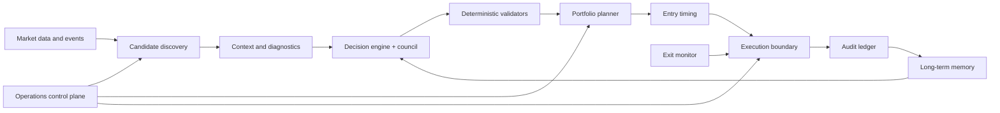

# The Kestrel Engine, Architecture

A kestrel windhovers: it flies into a heavy headwind while holding its head
mathematically still, watches the ground below, and dives at the exact moment.
That is the design ethos. Patience in chaos, deterministic timing, surgical
action.

This document names the 13 functional components of the engine, the role each
plays, the AI agents some of them own, and the failure modes worth watching. The
vocabulary is deliberately distinct from file paths, so logs and conversation can
say "Fulcrum's macro filter is too tight" instead of naming a module.

The spine of the system is a single rule: **language models do the judgment,
deterministic code holds the veto.** Models research, diagnose, rank, and
critique. Arithmetic, thresholds, sizing, validation, and state transitions live
in code. Nothing a model produces reaches a real order until it clears hard
checks in plain Python.

## What this document discloses

Component names, responsibilities, boundaries, and the model providers are
public. The following are intentionally absent, because they are the edge: exact
decision thresholds, scoring weights, allocation tables, the sub-sector
cyclicality model, universe inclusion rules, agent prompt contracts, internal
schemas, live positions, fills, PnL, account data, environment variables, state
paths, run commands, and operational runbooks. Where a public code file keeps its
structure, the calibrated numbers have been withheld.

## Theme: a cybernetic predator

The engine is structured like an autonomous bio-mechanical organism:

- **Sensory system** gathers raw environmental data.
- **Neural processing** weighs probabilities and synthesizes decisions.
- **Predatory instincts** react mechanically at the moment of opportunity.
- **Physical layer** routes orders and records reality.

## System flow

---

## Phase 1, Sensory system

Raw environmental data ingestion. No reasoning here, just acquisition.

### 1. Aperture
The lens. Scans the broader NSE universe and narrows it to "fallen angels":
quality names in deep drawdown that are worth deeper research.

- **Agents**: none (pure Python).
- **Inputs**: instrument master, daily candles for the configured universe.
- **Outputs**: a ranked, reproducible candidate set with price, 52-week high, and
  sector.
- **Public-safe note**: universe maintenance is separated from per-run screening,
  and the scan is rerunnable, cacheable, and auditable. The inclusion rules,
  drawdown band, and rejected buckets are withheld.
- **Failure modes**: stale universe list, split or dividend artifacts in price
  history, mis-tagged sub-sector taxonomy.

### 2. Pulse
The peripheral nervous system. Turns noisy corporate and market information into
structured evidence: filings, news, sub-sector context, and sentiment.

- **Agents**: a sub-sector outlook agent (recovery thesis per sub-sector).
- **Inputs**: corporate announcements, news, a FinBERT sentiment pipeline, sector
  context.
- **Outputs**: tagged filings, a sentiment volumetric (positive/negative/neutral
  counts and trend), and a per-sector outlook with an expected horizon.
- **Failure modes**: news-result drift across calls, source timeouts, filing
  keyword rules missing a new event type. A per-day cache stabilizes repeat runs.

### 3. Vector
Proprioception of the prey. The speed, magnitude, and trajectory of price action,
computed as pure math with no LLM, hot-path safe.

- **Agents**: none (deterministic).
- **Inputs**: a candle DataFrame, optional 52-week high, current price.
- **Outputs**: a structured technicals block (momentum, moving averages,
  volatility, support and resistance, anchored VWAP, volume profile, a phase
  label, and a knife-risk score).
- **Public-safe note**: this owns technical feature generation as structured data
  rather than mixing it into prompts. The indicator periods are textbook; the
  composite weights and rule boundaries are withheld.
- **Failure modes**: rule weights drift across regimes, phase rules brittle in
  chop, the knife-risk composite is opinionated by design.

### 4. Horizon
Environmental awareness. Reads the macro weather and classifies whether the world
is supportive, discounted, stressed, or in crisis.

- **Agents**: a macro classifier that wakes only when a quantitative tripwire
  fires, then reads aggregated headlines and returns a strict-JSON regime,
  severity, and root cause. Idle most days, cheap when it fires.
- **Inputs**: benchmark index candles, optional headlines at tripwire time.
- **Outputs**: a macro state (regime, severity 0 to 10, event type, root cause)
  with hysteresis so a single noisy day does not flip the regime.
- **Public-safe note**: the design keeps a quantitative pre-filter in front of the
  LLM so tokens are spent only on genuine events. The tripwire levels and severity
  cutoffs are withheld.
- **Failure modes**: beta instability across regimes, low-volatility false wakes,
  cap-band mis-mapping after a large drawdown.

---

## Phase 2, Neural processing

LLM-heavy. Each module weighs probabilities and synthesizes judgment, then hands
structured evidence to the next.

### 5. Nucleus
The core. Evaluates the fundamental, peer-relative quality of a company: is it
strong enough to deserve attention?

- **Agents**: a peer-context agent.
- **Inputs**: a fundamentals snapshot, a peer set, sector context from Pulse.
- **Outputs**: a relative-strength verdict, the peer set, and a structured
  scorecard.
- **Failure modes**: peer-set mis-selection, missing fundamentals, run-to-run
  variance. A per-day cache eliminates same-day variance.

### 6. Pathology
The autopsy. Diagnoses why a stock fell: a systemic shock, localized decay, or a
benign cause. Separates recoverable dislocation from permanent impairment.

- **Agents**: a news-diagnosis agent.
- **Inputs**: filings and sentiment from Pulse, peer drawdowns from Nucleus.
- **Outputs**: a fall-cause classification (company-specific, sector-wide, or
  mixed), a severity score, a confidence, and a structured thesis.
- **Failure modes**: severity inflation on opaque corporate actions, false
  company-specific labels when news is sparse.

### 7. Cortex
The frontal lobe. The master reasoning layer that ingests everything upstream and
produces a ranked decision set with reasons, risks, and rejections.

- **Agents**: a portfolio synthesizer (Anthropic Opus). The Council adds two
  independent critics.
- **Inputs**: per-stock dossiers, portfolio constraints, and macro state.
- **Outputs**: ranked picks, a rejected pile with reasoning, portfolio notes, and
  structured entry triggers.
- **Public-safe note**: Cortex combines deterministic gates with model-assisted
  review and keeps arithmetic, thresholds, and validation outside free-form model
  text. The gate list, tier rules, and expected-value formulas are withheld.

**The Council.** A primary author (Opus) emits the ranked view. Two reviewers,
Google Gemini and OpenAI Codex, receive that output plus the original dossiers and
emit structured critiques in parallel. The author then revises in the same JSON
contract. Any voice can fail (timeout, malformed output) and the run degrades
gracefully: a surviving reviewer still drives a revision, and if all critics fail
the original synthesis is the fallback. The full deliberation is persisted for
audit.

**Deterministic tier validation.** A reproducibility test showed the LLM would
occasionally assign a tier its own inputs did not support. A post-LLM validator
re-checks the structural tier criteria in code and downgrades any pick that does
not satisfy them, annotating the audit trail. The model stays in charge of
narrative, sizing, and prices; the structural tier decision is code-bound.

---

## Phase 3, Predatory instincts and portfolio

State machines and a deterministic planner. They do not reason; they size and
react mechanically.

### 8. Fulcrum
The pivot. An anti-falling-knife state machine that waits for selling pressure to
exhaust and a reversal to confirm before a candidate can move toward execution.

States: IDLE to IN_ZONE to EXHAUSTING to REVERSAL_CONFIRMED, with an INVALIDATED
edge from any state.

- **Agents**: a falling-knife interpreter that translates pre-computed technicals
  into structured entry and invalidation triggers. The math lives in Vector; the
  watcher evaluates the triggers mechanically against live ticks.
- **Inputs**: live ticks, current picks from Cortex, technicals refreshed at
  startup, macro severity, circuit limits, and a news-blackout window.
- **Outputs**: persisted state transitions and tranche signals.
- **Public-safe note**: this is a timing layer, not a thesis generator. It
  separates research conviction from execution timing. The confirmation rules and
  thresholds are withheld.
- **Failure modes**: the macro filter is tight for fallen angels by construction,
  divergence false positives in chop, feed disconnects.

### 9. Zenith
The portfolio brain. A fully deterministic position sizer and risk-gate enforcer
that bridges Cortex analysis and Fulcrum execution. It produces the day's
execution plan: per-pick action, sized quantity, entry range, and stop and target
levels, under capital and concentration constraints.

- **Agents**: none (no LLM in the brain).
- **Inputs**: the Cortex synthesis, the position book, pending orders, macro
  state, the sub-sector taxonomy, and the broker margin or a capital fallback.
- **Outputs**: an execution plan (latest plus a dated archive) with per-pick
  intents and risk-gate results.
- **Public-safe note**: Zenith centralizes sizing, exposure, and risk policy. The
  allocation table, capital caps, and position limits are withheld.

### 9b. Apex
The peak. The exit-side mirror of Fulcrum, split out of Zenith into its own
component. Fulcrum waits for selling to exhaust and a reversal up, then buys; Apex
waits for recovery demand to exhaust and a roll-over, then signals a sell.

States: HOLDING to VIGILANT to ARMED to EXHAUSTION_CONFIRMED to EXIT_FIRING to
EXTRACTED, with an INVALIDATED back-edge.

- **Agents**: none (deterministic).
- **Public-safe note**: Apex mirrors entry discipline on the exit side. It can run
  as an advisory or as an automation boundary depending on configuration. Its
  trigger formulas, automation flags, and shadow-versus-live behavior are
  withheld. In the default posture the engine performs no destructive automation:
  exits surface as operator alerts.
- **Failure modes**: trailing too tight in early recovery, and a daily-bar cadence
  that lags a fast intraday distribution (the intended fix is an executed-volume
  signal at tick cadence).

---

## Phase 4, Physical layer

Order placement, the record of truth, long-term memory, and day-to-day operation.

### 10. Talon
The strike. The controlled edge between internal intent and the broker. Limit
orders only, paper by default.

- **Agents**: none (deterministic).
- **Inputs**: Fulcrum and Zenith signals, the live-trading flag, and ledger state.
- **Outputs**: order records that move from pending to filled, broker calls (real
  or simulated), position-book updates on fill, and reconciliation reports.
- **Public-safe note**: Talon enforces safety checks before anything leaves the
  engine and records intent before execution, so a crash mid-order leaves an
  auditable trail. It is built around idempotency, reconciliation, and fail-loud
  visibility. A live-symbol whitelist and a master kill-switch gate live orders.
  Order tags, retry rules, and provider-specific handling are withheld.
- **Failure modes**: partial fills, broker rejection codes, double-record on a
  mid-call crash (addressed by idempotent records).

### 11. Ledger
Ground truth. The record of deployed capital, live exposure, realized outcomes,
and what the system actually did.

- **Agents**: none.
- **Public-safe note**: the ledger separates planned actions from observed
  outcomes and supports reconciliation, validation, and post-trade review. It
  reports drift against broker holdings rather than silently correcting it. State
  file names, schemas, and live positions are withheld.
- **Failure modes**: drift versus broker holdings (surfaced, operator-resolved),
  manual-edit corruption, partial fills mis-recorded.

### 12. Engram
The neural memory trace. A per-symbol markdown dossier that accumulates what the
system knew about a name across runs, what it decided, and how it played out, plus
an append-only refresh log.

- **Agents**: none today; a future compression agent.
- **Public-safe note**: Engram preserves research context and decision provenance
  so the engine does not restart from zero each run, and so it can learn from its
  own prior work. The dossiers themselves, tied to real names, are not public.
- **Failure modes**: growth without compression, stale frontmatter after a
  demote-then-repromote.

### 13. Kernel
The brainstem. The control plane that turns a collection of modules into an
operated system: preflight checks, validation gates, operator workflows, and
observability.

- **Agents**: a one-shot taxonomy-maintenance agent.
- **Public-safe note**: Kernel runs validation gates before downstream actions are
  allowed and provides repeatable run rituals. The commands, schedules,
  notification channels, and runbooks are withheld.
- **Failure modes**: the runbook drifting behind code, a missing check for a
  recently added component.

---

## Stack

- Python for analytics and orchestration.
- Tabular and columnar data processing.
- A multi-provider LLM adapter (Anthropic, Google Gemini, OpenAI Codex) with a
  transparent fallback ladder and telemetry, plus a local fallback for offline
  use.
- Deterministic rule engines for gates, risk checks, sizing, and validation.
- FinBERT for news sentiment.
- Schema validation and contract-style tests around artifacts that cross module
  boundaries.
- Audit-first state: decisions, intents, outcomes, and reviews are durable
  artifacts.
- Cloud-ready separation between core logic, adapters, operations, and runtime
  state.

## Versioning

Each component is versioned independently, so a Cortex improvement does not
require revalidating Talon. The named-component vocabulary is what makes that
possible: improvements, logs, and failure reports are all scoped to a single
boundary.
