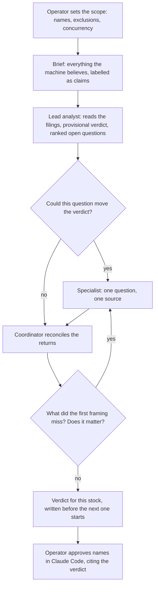

# The deep dive: an agentic investment committee

After the weekend research run, the machine has a ranked list of names it
would put money into. Before any of them can take new capital, each one goes
through a deep dive: a structured investigation, one stock at a time, run as
an investment committee meeting between the operator, a Claude Code session
acting as coordinator, and a small number of Opus research agents. The
machine's rating, thesis and numbers enter the room as claims to be tested
against primary filings, never as conclusions. The question each meeting
answers is narrow: is this a good business, mispriced, whose ordinary
shareholders actually get paid for the recovery inside the strategy's horizon?

The deep dive is a written procedure driven in chat. It is not a skill and not
an automated stage. Code holds two ends of it: the evidence brief going in, and
the approval record coming out.

## The flow

## The roles

| Role | Who | What it does |
|---|---|---|
| Scope | The operator | At the start of every run: which candidates, which exclusions, how many agents at once, and the investment frame. Nothing about names or caps is stored in the procedure itself. |
| Brief | A pre-read script | Pulls everything the machine believes about the name from the run's artefacts and labels it as claims: ratings before and after the council, the diagnosis and the news it saw, gates, peers, fundamentals, the entry geometry, the long-term memory dossier and any prior verdict. The script is adapted for each run rather than being a fixed tool; only the sector block comes from a tracked check tool, which prints the stored sector thesis with no model call. |
| Lead analyst | One Opus agent, alone | Reads the brief, the memory dossier and the primary filings, works out what the business actually is, answers the checks as far as those sources allow, and returns a provisional verdict plus a queue of open questions. Each question names the one primary source and the extract wanted. |
| Specialists | One Opus agent per question | One question, one source, one extract. Each returns **settled**, **still open** (naming the corroboration it would need), or **cannot be settled** from that source. |
| Coordinator | The Claude Code session | Decides what launches, reconciles what comes back, asks what the lead analyst's framing left out, and writes the verdict. |
| Approval | The operator | Reads the verdicts and records which names take new capital. |

The "chair" on the deck is this split: the Claude Code session runs the
meeting, and the operator owns its two decisions, what is in scope at the
start and what gets approved at the end.

## How questions are chosen

The lead analyst ranks its open questions by how far each could move the
verdict (or, for a name already held, the standing decision on it). Each
question is graded to launch, to launch only if adding to a held position is
being considered, or not to launch (already settled, or unanswerable until a
known future event). The coordinator may drop, merge or add questions before
launching. When an agent finishes, its slot goes to the next question in the
queue, or to a new question that outranks it.

## The checks

Every fully reviewed stock must answer a fixed set of checks before it can
close. Six of them are below; the deck's five are the first three and the last
two:

1. **Why it fell**, from the filings around the peak, not from the window the
   machine happened to read: company or sector, structural or transient.
2. **How it fails**, before anything is valued: the credible failure
   mechanisms, the conditions each needs, the evidence for and against, and
   what would be an early warning versus a thesis-breaking fact. Missing
   evidence never makes a threat unlikely.
3. **Why the earning power holds**: what defends it, and whether the balance
   sheet carries the company through the failure cases.
4. **Earning power per share**, reconciled from reported results to the real
   economics, with one-off items and share-count changes shown.
5. **Who gets paid**: pledges and other encumbrances, promoter conduct,
   related parties, the auditor, dilution, capital allocation.
6. **What it is worth against its price**: an independent range with its
   assumptions. A big fall or a low multiple is not value on its own.

The remaining checks cover the return case inside the horizon (including a
delayed case and a case with no re-rating), the calendar and entry geometry,
and how the weekly sector thesis bears on this particular company. The sector
thesis is itself checked against its sources and ruled confirmed or disputed.

A check can close as "insufficient evidence" if its effect on the verdict is
stated. The method beyond the checks is chosen per stock: a lender, a
manufacturer and a holding company are read differently.

## The rules, and why

- **The machine's rating is a claim, not a conclusion.** The deep dive exists
  because the pipeline's known weak points (a news window that misses the
  cause of the fall, numbers that flatter, tiers that move with no new facts)
  are exactly what a confident summary hides.
- **One question, one source, one agent.** A narrow brief returns an answer
  that can be checked. Two agents agreeing is not corroboration if they read
  the same thing.
- **Ask how it fails before asking what it is worth.** Valuation first anchors
  the analysis on the upside.
- **Every claim is labelled** fact, inference, forecast, contradiction or not
  found, with its source, and opposing evidence stays visible.
- **At most five agents at once, and agents cannot start agents.** This is a
  standing rule written into every agent brief, not something code enforces.
  It keeps the run legible and the spend bounded.
- **Each verdict is written before the next stock starts,** so a later name
  cannot quietly reshape an earlier conclusion.
- **No new capital is a valid outcome.** When a rule is uncertain, the branch
  that skips the trade wins.

## How it ends in an approval

Each stock closes with a verdict: **confirm**, **confirm with caveats**, or
**fail**, with whether to fund it, the credible adverse outcome and its size,
and the warning signs to watch. A held name gets a standing verdict instead
(hold, do not add, and so on); an early exit is on the table only for fraud or
malice.

The operator then records approvals in Claude Code. The approval tool is
explicit-only: a name takes new capital only if it is named, and every
unnamed candidate drops as not reviewed. A name that is not already held
cannot be approved without a recorded verification verdict, or a named
override that the record keeps. On a run that served the sector thesis, an
approval also needs a ruled check of that thesis, and a sector read against
the name needs a stated reason it does not apply. The override can cross those
demands, but never a finding that no such reason exists. The verdict and
reason vocabularies live in [`core/verdicts.py`](../core/verdicts.py).

## What is code and what is procedure

| Code | Procedure |
|---|---|
| The sector block in the brief | The rest of the brief (a per-run script) |
| The verdict, reason and motive vocabularies | The roles, the checks, the question ranking |
| The demand for a verdict or a named override before new capital | The five-agent cap and the no-nesting rule |
| The explicit-only approval record | The claim labels and the omission question |

## Honest limits

- **Most of this is discipline, not enforcement.** The code checks that a
  verdict was recorded, not what it says: it treats a fail as "the operator
  went and looked", and does not itself refuse an approval that cites one.
- **Not every candidate gets the full meeting.** In practice some stop after
  the lead analyst's scope-out or a lighter screen, and the full procedure runs
  on the names the operator picks for it.
- **The brief script is not a fixed tool,** so its exact contents can drift
  between runs.
- **The probabilities are subjective.** The return estimates are the
  analyst's judgment, recorded as such, never reached by tuning an assumption.
